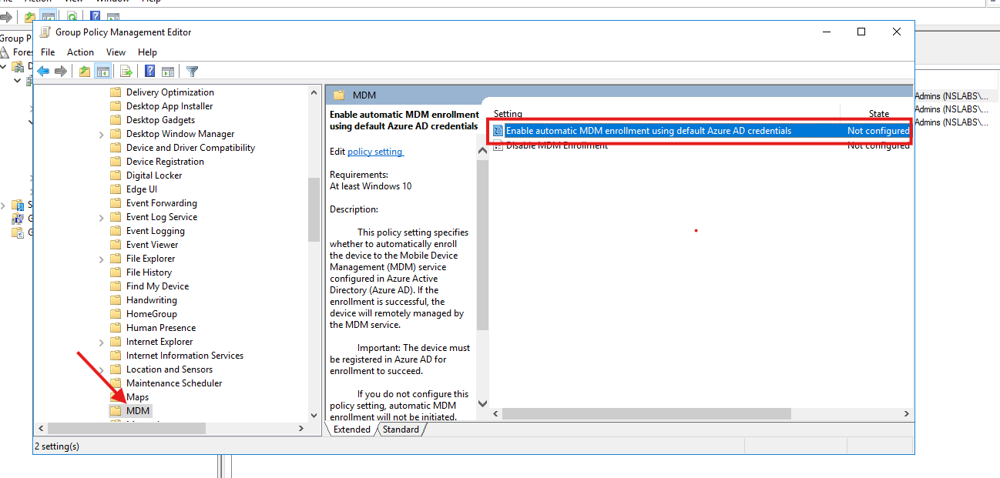
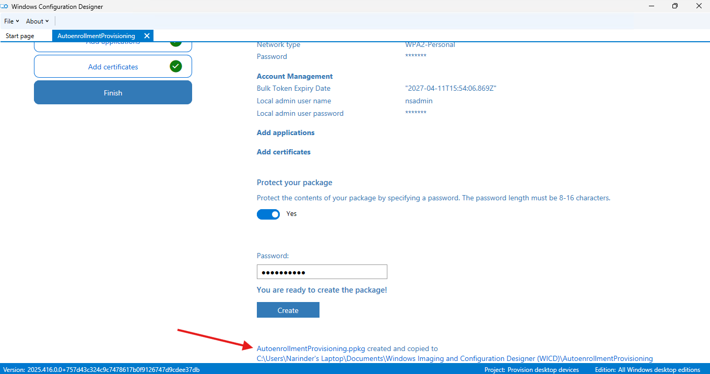

# Microsoft Intune Administration Portfolio

This repository documents my hands-on Microsoft Intune, Microsoft Entra ID, Windows 11, and Windows Server administration in non-production lab environments. The work covers device registration, dynamic device groups, enrollment readiness, Managed Google Play integration, enrollment restrictions, Group Policy troubleshooting, provisioning-package creation, and policy-set administration.

Each workstream explains the configuration, verification, and troubleshooting performed, with selected screenshots directly beneath the relevant technical phase. The complete lab screenshot archive is available for deeper review.

> Lab context: Lab accounts, device names, domains, groups, and configuration values remain visible. Personal email addresses and access-enabling values are not published.

---

## Portfolio Workstreams

| Workstream | Work completed | Documentation |
|---|---|---|
| Device Registration & Dynamic Groups | Added a Windows work account, verified the registered device with MDM None, and created a dynamic security group using Windows OS-version criteria. | [View workstream](docs/device-registration-dynamic-groups.md) |
| Enrollment Readiness & Restrictions | Validated Windows enrollment CNAME discovery, connected Managed Google Play, created a three-device restriction, and reviewed ESP, Apple prerequisites, and Windows enrollment entry points. | [View workstream](docs/enrollment-readiness-restrictions.md) |
| Group Policy Enrollment & Template Troubleshooting | Restored the missing automatic MDM enrollment setting by updating a backed-up SYSVOL Central Store; selected Enabled and User Credential and reviewed the domain-linked GPO. | [View workstream](docs/group-policy-automatic-enrollment.md) |
| Windows Provisioning Package | Built a password-protected provisioning package with randomized device naming, Wi-Fi settings, a local administrator account, and a successfully retrieved bulk token. | [View workstream](docs/windows-provisioning-package.md) |
| Policy Set Administration | Created Toronto Policy Set, selected a user-group assignment, and confirmed Assigned status; reviewed payload selectors without adding deployment objects. | [View workstream](docs/policy-set-administration.md) |

---

## Core Technical Skills & Tools

- **Microsoft Intune:** Enrollment configuration review, CNAME validation, enrollment restrictions, Managed Google Play integration, Enrollment Status Page review, and policy-set administration.
- **Microsoft Entra ID:** Windows device registration, device-record interpretation, dynamic device membership rules, security groups, and user-group targeting.
- **Windows 11:** Access work or school, domain-membership review, Company Portal preparation, and Windows Configuration Designer.
- **Windows Server & Group Policy:** Group Policy Management, domain-linked GPOs, automatic MDM enrollment policy settings, SYSVOL Central Store creation, ADMX/ADML maintenance, and template backup.
- **Provisioning:** Device-name patterns, Wi-Fi configuration, bulk-token retrieval, local administrator configuration, password-protected package creation, and output-file verification.
- **Troubleshooting & Documentation:** Missing-policy diagnosis, configuration versus enrollment verification, screenshot analysis, phase-based Markdown documentation, and evidence organization.

---

## Selected Evidence

### Device registration and dynamic group creation

  
  

_Left: The registered Windows device is listed with MDM None. Right: The portal confirms creation of the Toronto Windows 11 Devices group._

### Enrollment discovery and Android Enterprise readiness

  
  

_Left: Windows enrollment CNAME validation succeeds for narindersharmalabs.xyz. Right: Managed Google Play is connected and shows Setup._

### Group Policy remediation and provisioning-package output

  
  

_Left: The previously missing automatic MDM enrollment setting is available after the template update. Right: Windows Configuration Designer confirms creation of the protected provisioning package._

---

## Repository Navigation

- [Project overview](docs/project-overview.md)
- [Complete lab evidence index](docs/evidence-index.md)
- [Screenshot archive](screenshots)
- [Screenshot publishing notes](docs/screenshot-publishing-notes.md)
- [Microsoft 365 & Entra ID Administration Portfolio](https://github.com/nrscertifications/microsoft-365-entra-admin-portfolio)

## Intended Role Alignment

- IT Support Technician
- Service Desk Analyst
- Desktop Support Technician
- Endpoint Support Technician
- Junior Systems Administrator
- Junior Microsoft 365 / Intune Administrator
