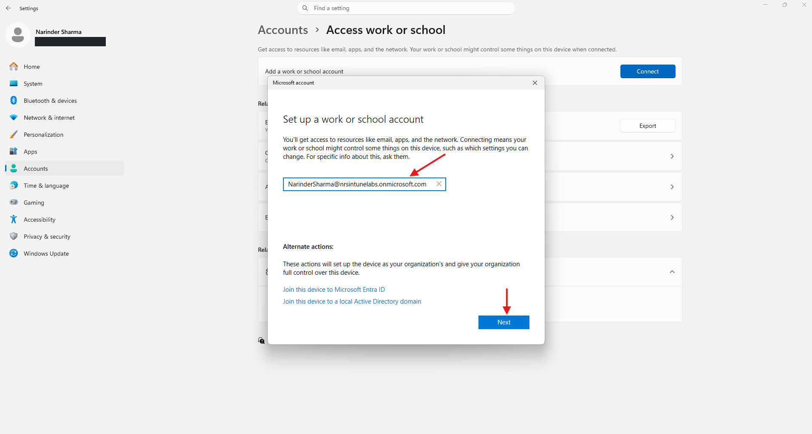
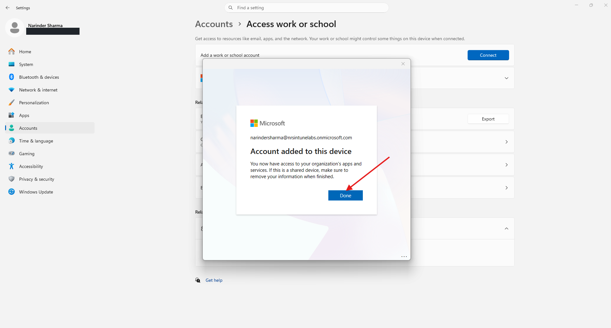
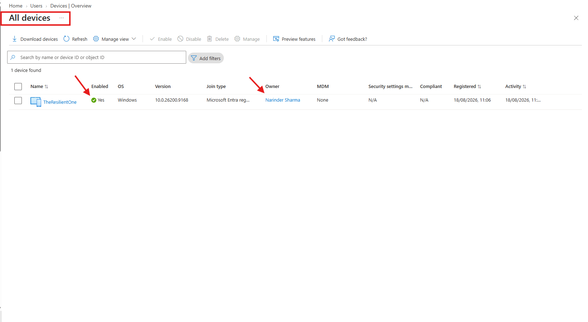
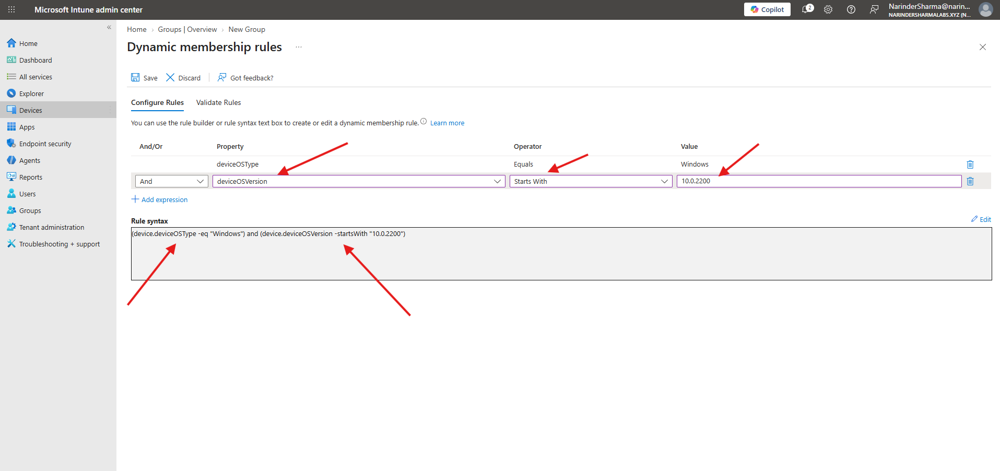
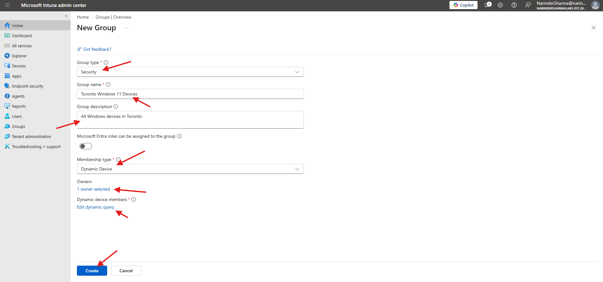
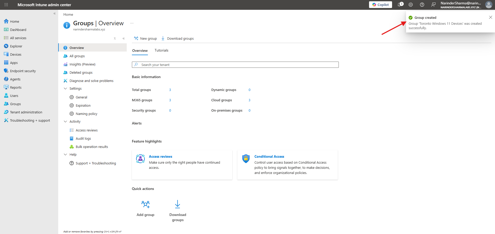

# Windows Device Registration & Dynamic Device Groups

This work covers Windows work-account registration and dynamic device-group creation. The registration sequence uses `nrsintunelabs.onmicrosoft.com`; the later group workflow uses the separate `narindersharmalabsxyz.onmicrosoft.com` tenant.

## Work Completed

- Reviewed the lab identity before connecting the Windows work account.
- Completed the standard Access work or school account-registration workflow.
- Reviewed the resulting Entra device record and its MDM status.
- Created `Toronto Windows 11 Devices` as a security group with Dynamic Device membership and a selected owner.
- Configured Windows OS-type and OS-version criteria and confirmed successful group creation.

## Phase 1 — Register the Windows Work Account

I opened Settings > Accounts > Access work or school, selected Connect, and entered the lab account. I used the standard work-account connection flow rather than selecting the separate Join this device to Microsoft Entra ID action. Windows displayed the registration progress and then confirmed that the account had been added.

<p align="center">
  <a href="../screenshots/01-device-registration-and-groups/01-windows-device-registration/04-work-account-registration-sign-in.png"></a>
  <a href="../screenshots/01-device-registration-and-groups/01-windows-device-registration/07-work-account-added-confirmation.png"></a>
</p>

_Left: The nrsintunelabs work account entered in the standard Connect flow. Right: Windows confirms that the account was added. The personal email address in the Settings sidebar is redacted._

## Phase 2 — Review Device Registration and Management State

I reviewed `TheResilientOne` in the Entra device list. The record shows Windows version `10.0.26200.9168`, an enabled device, the registered join-type entry, and the listed owner. The MDM column is `None` and compliance is `N/A`, so the verified outcome is device registration rather than Intune enrollment.

<p align="center">
  <a href="../screenshots/01-device-registration-and-groups/01-windows-device-registration/08-entra-device-registration-mdm-none.png"></a>
</p>

_The registered Windows device record, including MDM None and compliance N/A._

## Phase 3 — Configure Dynamic Device Membership

In the later Intune tenant, I configured a dynamic device rule and prepared the security group `Toronto Windows 11 Devices` with one selected owner.

```text
(device.deviceOSType -eq "Windows") and (device.deviceOSVersion -startsWith "10.0.2200")
```

The rule selects Windows devices whose reported version begins with `10.0.2200`. It is a build-prefix rule, not a complete selector for every Windows 11 version. The group name and description refer to Toronto, but the rule itself contains no location condition.

<p align="center">
  <a href="../screenshots/01-device-registration-and-groups/02-dynamic-device-groups/01-windows-os-version-dynamic-membership-rule.png"></a>
  <a href="../screenshots/01-device-registration-and-groups/02-dynamic-device-groups/02-toronto-windows-device-group-configuration.png"></a>
</p>

_Left: Windows and OS-version prefix criteria in the dynamic rule. Right: Security group configuration with Dynamic Device membership and a selected owner._

## Phase 4 — Confirm Group Creation

I submitted the group configuration and confirmed the successful creation notification. The overview counters in the background had not refreshed, so the notification is the creation evidence; evaluated group membership is not shown in this sequence.

<p align="center">
  <a href="../screenshots/01-device-registration-and-groups/02-dynamic-device-groups/03-toronto-device-group-created-confirmation.png"></a>
</p>

_Successful creation notification for Toronto Windows 11 Devices._

## Skills Demonstrated

- Windows work-account registration
- Microsoft Entra device-record review
- Registration and MDM-status interpretation
- Security-group creation and owner selection
- Dynamic device membership using OS-type and version-string criteria
- Accurate interpretation of group targeting

## Result

The Windows work account was connected and the device registration was verified. In a separate lab tenant, the dynamic security group was created successfully with the documented Windows build-prefix rule.

The complete screenshot sequence is available in [screenshots/01-device-registration-and-groups](../screenshots/01-device-registration-and-groups).
