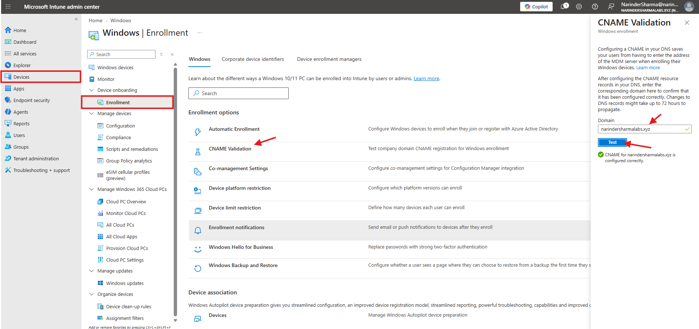
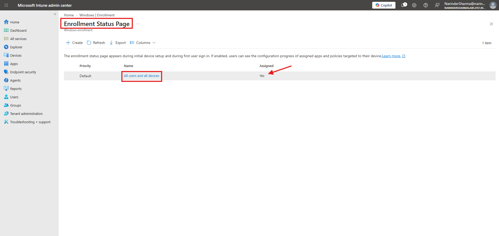
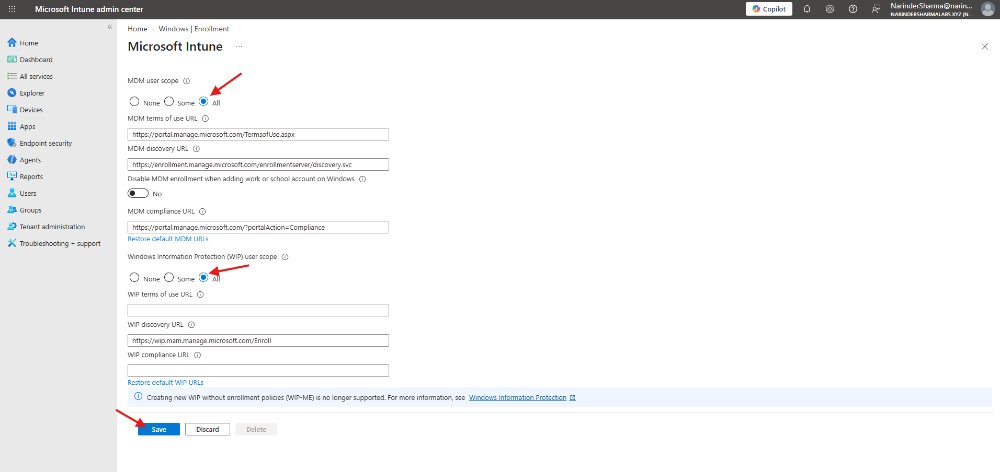
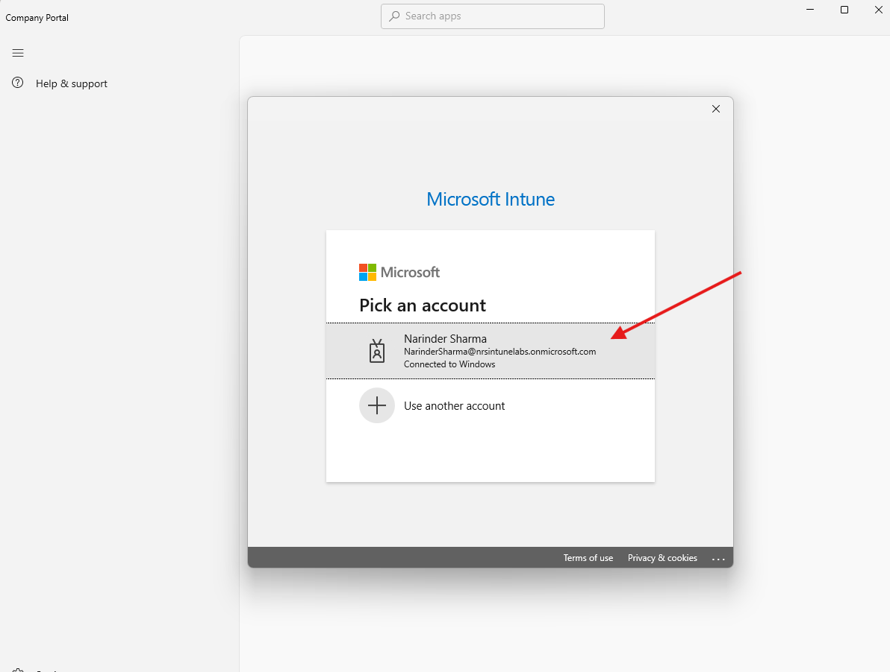
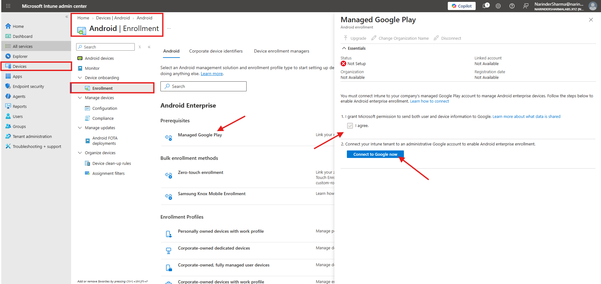
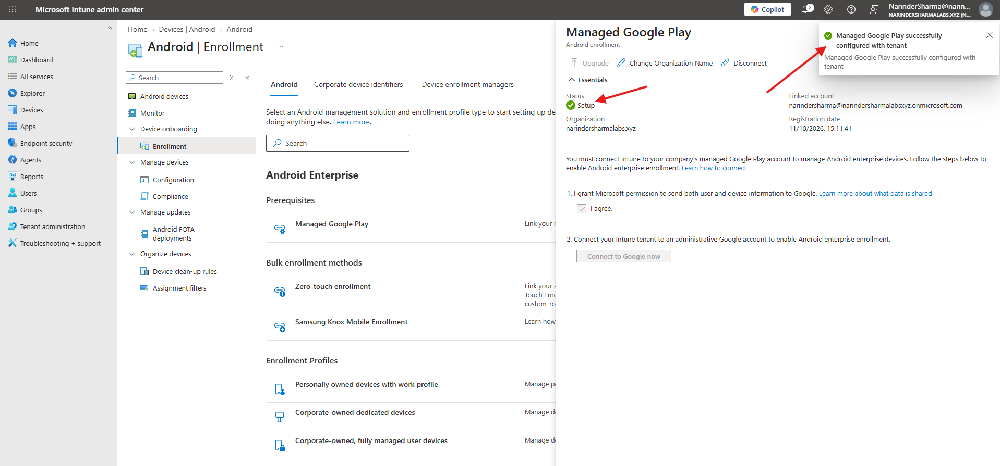
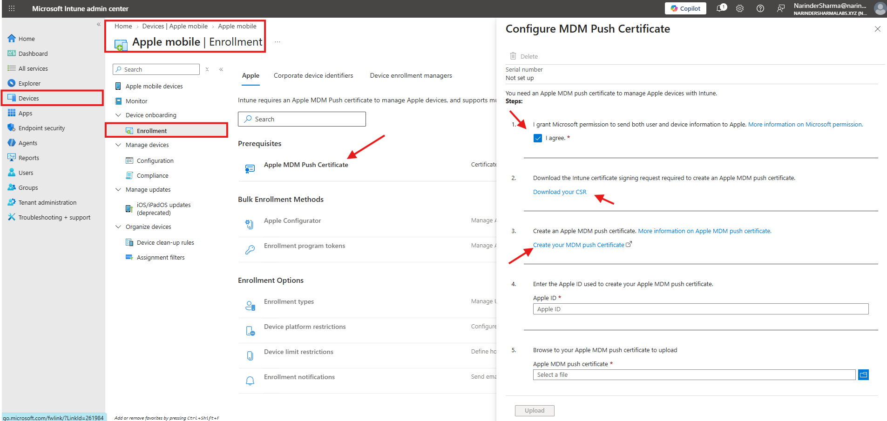
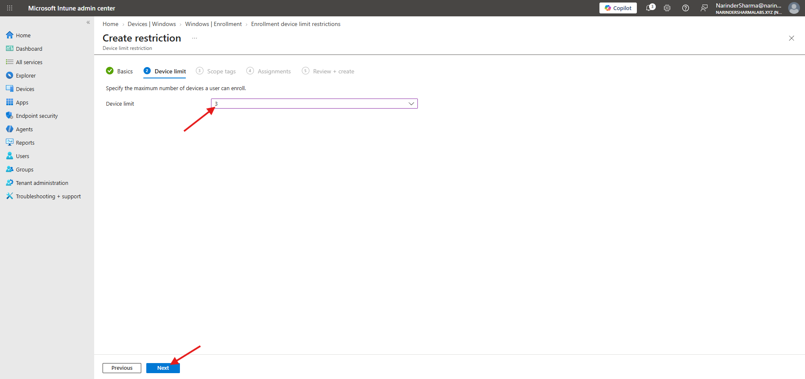
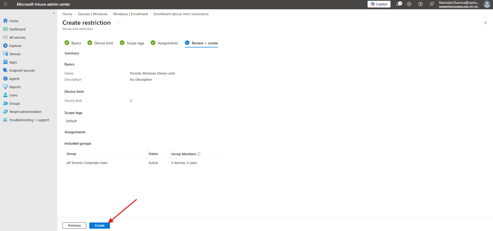
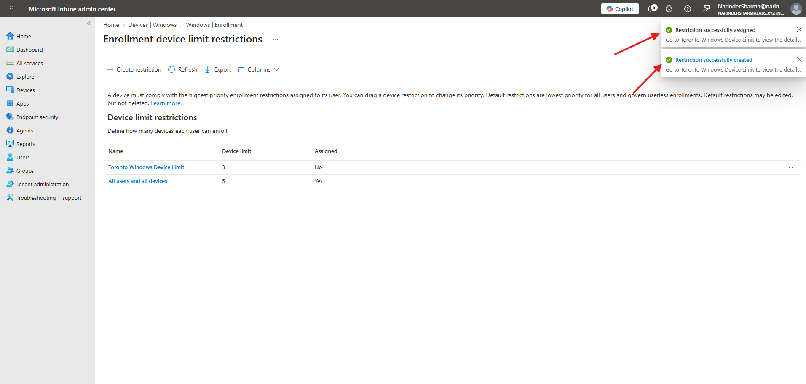

# Enrollment Readiness, Mobile Prerequisites & Restrictions

This work covers enrollment preparation in the `narindersharmalabsxyz.onmicrosoft.com` Intune tenant and its `narindersharmalabs.xyz` custom domain. A separate Company Portal account-selection screenshot uses the earlier `nrsintunelabs.onmicrosoft.com` account.

## Work Completed

- Validated the Windows enrollment CNAME for the custom domain.
- Reviewed the existing default Enrollment Status Page entry.
- Selected All for MDM user scope and reviewed the default MDM service URLs.
- Reviewed the manual Windows enrollment entry point and launched Company Portal to account selection.
- Connected Managed Google Play and confirmed Setup status.
- Reviewed Apple MDM push certificate prerequisites.
- Created `Toronto Windows Device Limit` with a maximum of three devices and selected `All Toronto Corporate Users` in the assignment workflow.

## Phase 1 — Validate Windows Enrollment Discovery

I tested `narindersharmalabs.xyz` in Windows Enrollment CNAME Validation. Intune reported that the CNAME was configured correctly. I also reviewed the existing default `All users and devices` Enrollment Status Page entry, which was listed as assigned. The screenshot records the ESP inventory entry rather than a newly configured ESP profile.

  
  

_Left: Successful Windows enrollment CNAME validation. Right: The existing default Enrollment Status Page entry shown as assigned._

## Phase 2 — Review Automatic and Manual Enrollment Preparation

I selected All for the MDM user scope and reviewed the terms-of-use, discovery, and compliance URLs. The screenshot captures those configuration choices with Save available; a saved-state confirmation is not included.

On the Windows client, I reviewed the separate Enroll only in device management action. That client screenshot shows an existing connection to the `NSLABS` AD domain. I also obtained Company Portal from Microsoft Store and opened its account-selection prompt. The available account in that prompt belongs to the earlier registration tenant.

  
  

_Left: MDM user scope shows All and the default service URLs. Right: Company Portal reaches account selection using the earlier nrsintunelabs account._

The Windows domain connection and the Company Portal account picker are preparation evidence; neither screen shows a completed MDM enrollment.

## Phase 3 — Connect Managed Google Play

I opened the Android enrollment prerequisites, started the Managed Google Play connection, entered the current lab work account, and completed the account-consent workflow. The returned Intune view showed Setup and a successful tenant-configuration notification.

  
  

_Left: Managed Google Play before connection, showing Not Setup. Right: The connector shows Setup and successful tenant configuration._

This verifies the Android Enterprise connector prerequisite. No Android device enrollment is shown in this batch.

## Phase 4 — Review Apple Enrollment Prerequisites

I reviewed the Apple MDM push certificate configuration, selected the consent checkbox, and identified the CSR download and certificate-creation entry points. In my tenant screenshot, the certificate status remains Not set up and the Apple ID and upload fields are empty.

  

_Apple MDM push certificate prerequisites reviewed in the current lab tenant; certificate setup remains incomplete._

## Phase 5 — Create the Three-Device Enrollment Restriction

I reviewed the default limit of five devices, then created `Toronto Windows Device Limit` with a limit of three. I selected `All Toronto Corporate Users`, retained the Default scope tag, and reviewed the configuration before creation. The group showed zero users and devices at that point.

  
  

_Left: The custom device limit set to three. Right: The review summary includes the selected user group and Default scope tag._

The portal displayed both creation and assignment success notifications. The same list still showed Assigned = No for the new restriction, so the saved assignment requires a refreshed Properties check before it is treated as verified.

  

_The new three-device restriction appears alongside the default five-device restriction. The notifications and Assigned column show the assignment-status discrepancy._

The name `Toronto Windows Device Limit` is an administrative label. A device-limit policy controls the number of devices a user can enroll in applicable enrollment scenarios; its name does not make it Windows-only or a geographic restriction.

## Skills Demonstrated

- Intune Windows enrollment discovery validation
- MDM user-scope and service-URL review
- Enrollment Status Page inventory review
- Windows manual-enrollment and Company Portal preparation
- Managed Google Play integration
- Apple MDM push certificate prerequisite review
- Device-limit restriction creation and user-group selection
- Assignment-status review

## Result

Windows enrollment CNAME discovery was validated, Managed Google Play was connected, and the three-device restriction was created. Automatic-enrollment saved state, restriction-assignment persistence, Apple certificate setup, and device enrollment remain separate verification steps.

The complete screenshot sequence is available in [screenshots/02-enrollment-readiness-and-restrictions](../screenshots/02-enrollment-readiness-and-restrictions).
