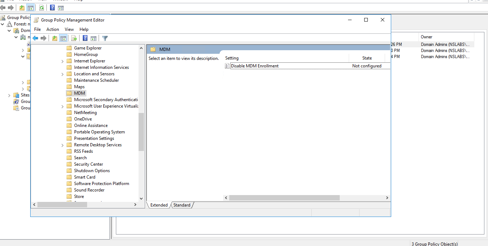
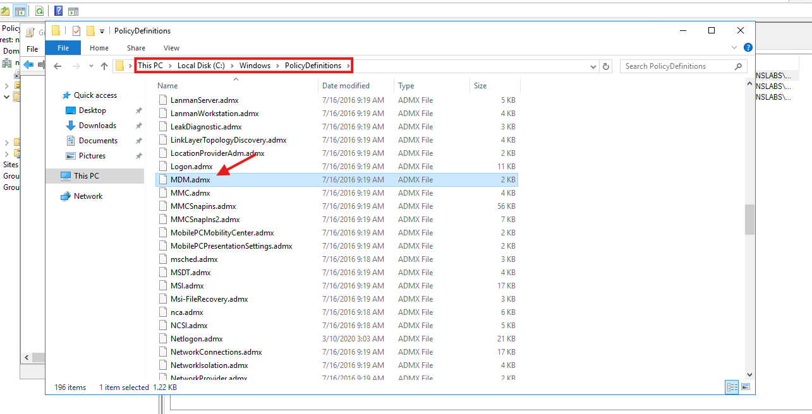
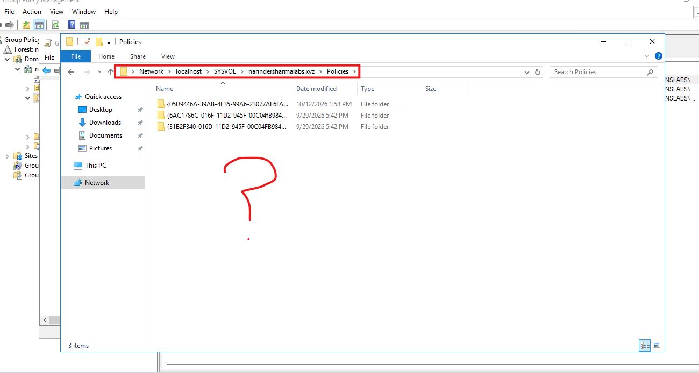
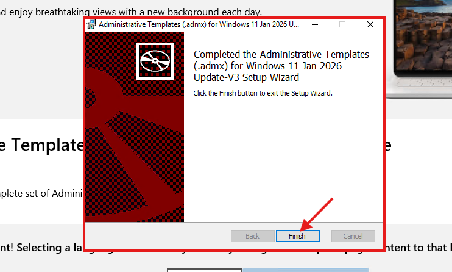
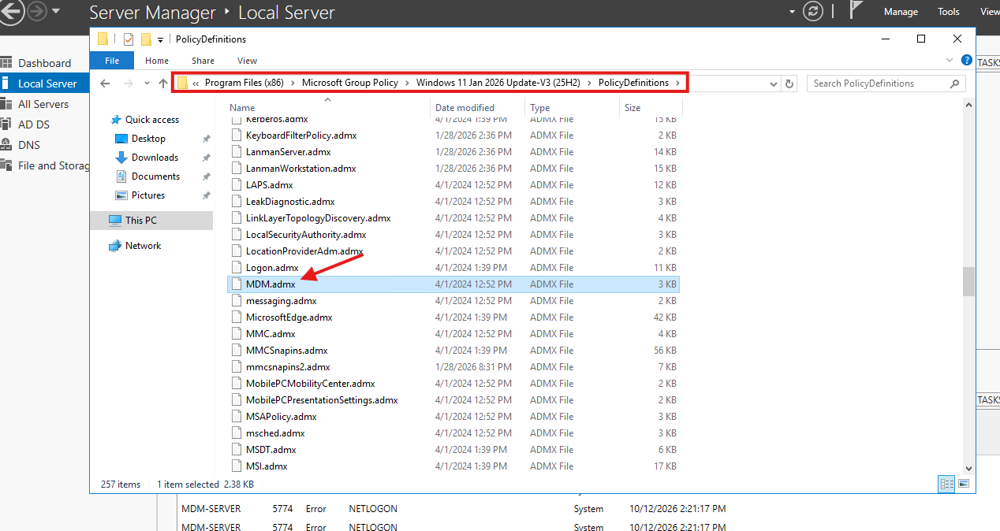
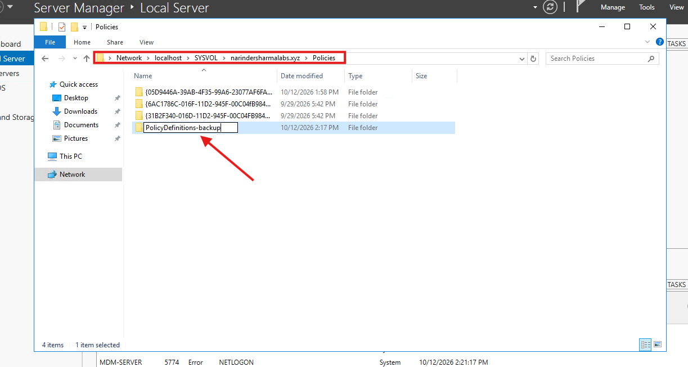
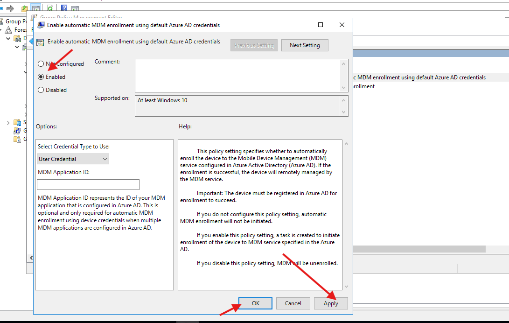
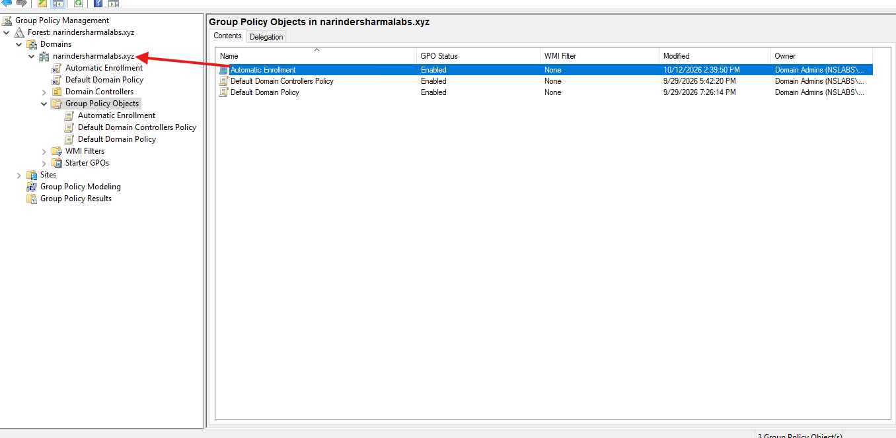

# Group Policy Enrollment & Administrative Template Troubleshooting

This work prepared automatic MDM enrollment policy configuration on `MDM-Server`, a Windows Server 2016 domain controller in `narindersharmalabs.xyz` (`NSLABS`). It also documents the missing-policy issue and the Central Store update that restored the setting.

## Work Completed

- Inspected the MDM Administrative Templates category and identified the missing automatic-enrollment setting.
- Located the older local `MDM.admx` and checked the domain SYSVOL policy directory.
- Created an initial `PolicyDefinitions` Central Store.
- Installed the newer Windows 11 25H2 V3 Administrative Templates package.
- Located the updated MDM template and its language-resource directory.
- Preserved the initial Central Store as `PolicyDefinitions-backup` before copying the updated template collection.
- Confirmed that the automatic MDM enrollment setting became available.
- Prepared the `Automatic Enrollment` GPO, selected Enabled with User Credential, and reviewed its domain-level link.

## Phase 1 — Diagnose the Missing Enrollment Setting

The MDM policy category initially exposed only Disable MDM Enrollment. I checked `C:\Windows\PolicyDefinitions` and found `MDM.admx`, but it belonged to the older local template collection. I then inspected the domain SYSVOL Policies directory and confirmed that no `PolicyDefinitions` Central Store existed.

<p align="center">
  <a href="../screenshots/03-group-policy-automatic-enrollment/01-central-store-troubleshooting/01-automatic-mdm-enrollment-policy-missing.png"></a>
  <a href="../screenshots/03-group-policy-automatic-enrollment/01-central-store-troubleshooting/02-older-local-mdm-admx-found.png"></a>
</p>

_Left: Automatic MDM enrollment is missing from the MDM category. Right: The existing local MDM.admx has an older 2016 timestamp._

The missing Central Store alone does not explain the absent setting: the local template set was also old. I recorded both checks before updating the templates.

## Phase 2 — Establish the Central Store and Install Updated Templates

I initially copied the server's local `PolicyDefinitions` directory into SYSVOL, then obtained and installed the newer Administrative Templates package. The download page identifies Windows 11 2025 Update 25H2 V3.0; the installed package identifies itself as Windows 11 Jan 2026 Update-V3 (25H2).

The Central Store location used by this domain is:

```text
\\narindersharmalabs.xyz\SYSVOL\narindersharmalabs.xyz\Policies\PolicyDefinitions
```

<p align="center">
  <a href="../screenshots/03-group-policy-automatic-enrollment/01-central-store-troubleshooting/03-sysvol-central-store-absent.png"></a>
  <a href="../screenshots/03-group-policy-automatic-enrollment/01-central-store-troubleshooting/08-administrative-templates-installation-completed.png"></a>
</p>

_Left: The SYSVOL Policies directory before a Central Store was present. Right: The newer Administrative Templates installation completes successfully._

## Phase 3 — Back Up and Refresh the Template Collection

I located the installed `MDM.admx` and reviewed the `en-US` language-resource folder. Before replacing the initial Central Store, I renamed it `PolicyDefinitions-backup`. I copied the updated `PolicyDefinitions` collection from the installed package location into the domain SYSVOL Policies directory.

<p align="center">
  <a href="../screenshots/03-group-policy-automatic-enrollment/01-central-store-troubleshooting/09-updated-mdm-admx-package-location.png"></a>
  <a href="../screenshots/03-group-policy-automatic-enrollment/01-central-store-troubleshooting/11-central-store-backup-preserved.png"></a>
</p>

_Left: The updated MDM.admx in the installed Windows 11 template collection. Right: The existing Central Store preserved as PolicyDefinitions-backup._

The copy screenshot captures transfer progress at 10 percent. I used the subsequent Group Policy editor view to verify the operational result: the previously missing automatic-enrollment setting was now available.

<p align="center">
  <a href="../screenshots/03-group-policy-automatic-enrollment/01-central-store-troubleshooting/14-automatic-mdm-enrollment-policy-restored.png"></a>
</p>

_The automatic MDM enrollment setting is restored in the editor. It is Not configured at this verification stage._

## Phase 4 — Prepare the Automatic Enrollment GPO

I opened the `Automatic Enrollment` GPO, selected Enable automatic MDM enrollment using default Azure AD credentials, and selected Enabled with User Credential. The older Azure AD wording is the label displayed by the template; it refers to Microsoft Entra credentials.

I also reviewed the GPO beneath the domain node. Its presence there demonstrates the domain-level link. The GPO Status = Enabled value refers to the GPO's overall status, not proof of the individual setting or client enrollment.

<p align="center">
  <a href="../screenshots/03-group-policy-automatic-enrollment/02-automatic-enrollment-gpo/05-automatic-mdm-enabled-user-credential-selection.png"></a>
  <a href="../screenshots/03-group-policy-automatic-enrollment/02-automatic-enrollment-gpo/07-automatic-enrollment-link-annotated.png"></a>
</p>

_Left: Enabled and User Credential selected in the automatic-enrollment policy dialog. Right: The Automatic Enrollment GPO and its domain-level link._

The policy dialog still exposes Apply and OK in the captured frame. A saved Settings report and client-side result are the remaining checks for the GPO configuration and enrollment outcome.

## Troubleshooting Record

| Issue | Checks and actions | Verified result |
|---|---|---|
| Automatic MDM enrollment policy was missing | Checked the older local MDM.admx, inspected SYSVOL, created a Central Store, installed updated templates, preserved the existing collection, and copied the newer ADMX/ADML collection | The automatic-enrollment setting became available in the editor |

## Skills Demonstrated

- Group Policy Management and GPO navigation
- SYSVOL Central Store creation and maintenance
- Administrative Template version review
- ADMX and language-resource organization
- Template backup before replacement
- Missing-policy diagnosis and remediation verification
- Automatic MDM enrollment policy preparation
- User Credential selection and domain-level GPO linking

## Result

The template issue was resolved and the automatic MDM enrollment setting was restored. The domain-linked GPO was prepared with Enabled and User Credential selected. This sequence establishes policy readiness; successful client enrollment is not yet shown.

The complete screenshot sequence is available in [screenshots/03-group-policy-automatic-enrollment](../screenshots/03-group-policy-automatic-enrollment).
