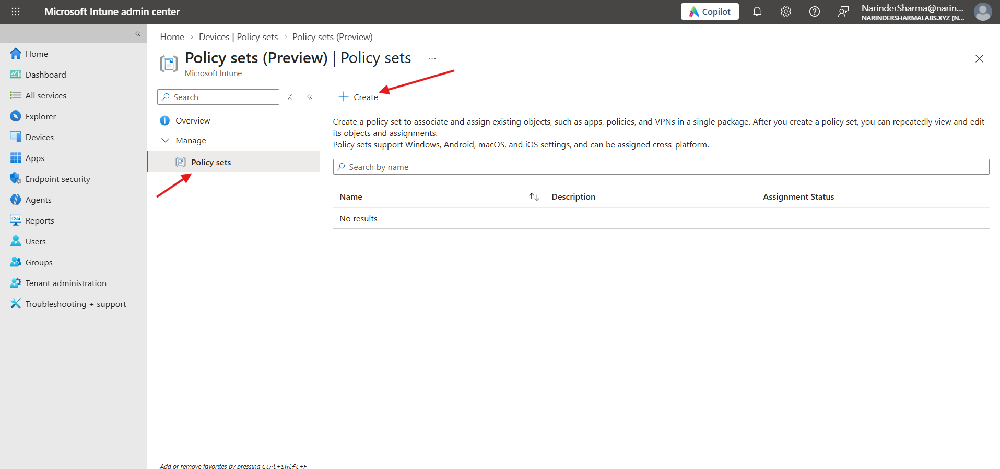
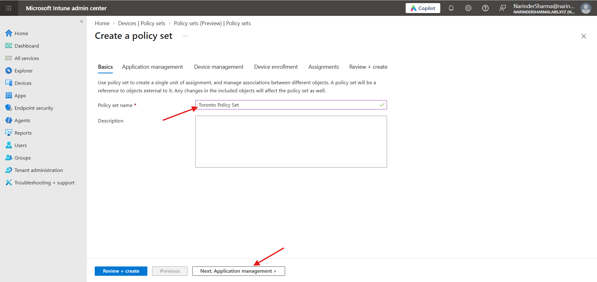
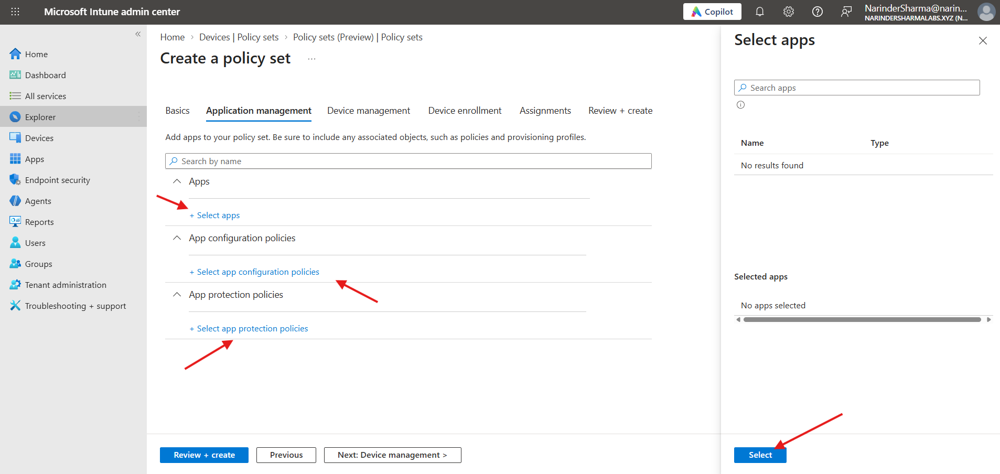
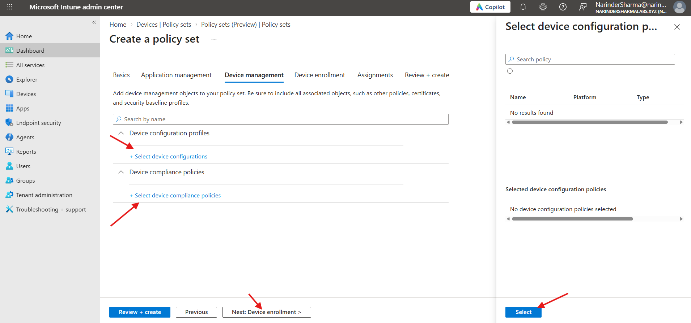
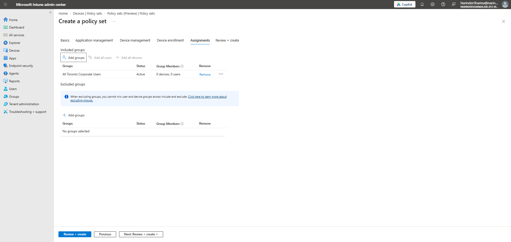
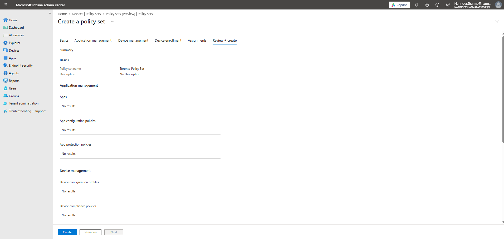
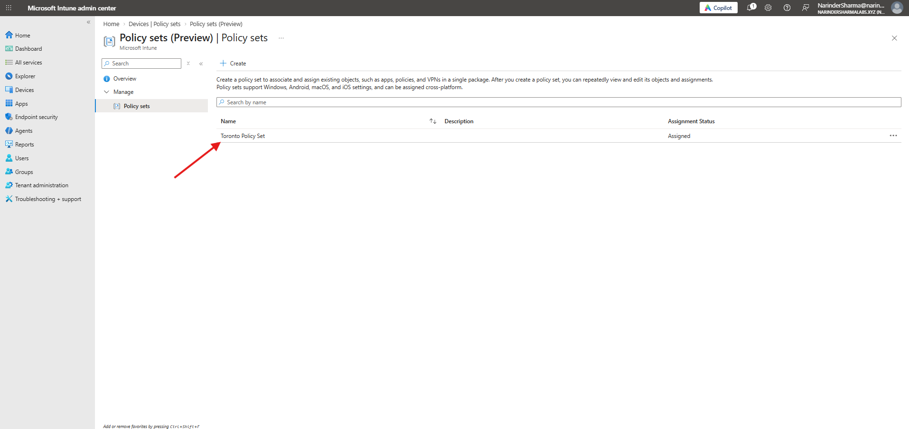

# Policy Set Administration & Group Targeting

This work created a policy-set container in the current Intune lab tenant, reviewed its supported management-object selectors, and configured a user-group assignment. The captured workflow shows no selected deployment payloads.

## Work Completed

- Reviewed the policy-set management overview and creation workflow.
- Created the container `Toronto Policy Set`.
- Reviewed application, app configuration, app protection, device configuration, compliance, Autopilot, and Enrollment Status Page selection surfaces.
- Selected `All Toronto Corporate Users` as the included group, with no exclusions.
- Reviewed the summary and confirmed that the new policy set appeared with Assignment Status = Assigned.

## Phase 1 — Define the Policy Set

I opened the policy-set list and created `Toronto Policy Set`. A policy set references existing management objects; the creation workflow does not itself create applications or configuration profiles.

  
  

_Left: The policy-set list before creation. Right: The Toronto Policy Set name entered in the Basics step._

## Phase 2 — Review Management-Object Selection

I reviewed the application and device-management selectors. The available app and device-configuration lists showed no results, and no items were selected. I also reviewed the Autopilot and Enrollment Status Page entry points. The Autopilot selector showed no results, and the enrollment page stated that enrollment restrictions were no longer available in policy sets.

  
  

_Left: The empty application selector and app-policy entry points. Right: The empty device-configuration selector and compliance-policy entry point._

This phase demonstrates review of the policy-set composition workflow. It does not represent application deployment, compliance-policy creation, or Autopilot configuration.

## Phase 3 — Configure the User-Group Assignment

I selected `All Toronto Corporate Users` as the included group and left exclusions empty. The group showed zero users and devices in the captured assignment view.

  
  

_Left: The included user group with no exclusions and zero displayed members. Right: The review summary with no payloads in the displayed application and device-management categories._

## Phase 4 — Confirm Creation and Assignment Status

I submitted the policy set and confirmed that `Toronto Policy Set` appeared in the list with Assignment Status = Assigned. This verifies creation and group targeting of the container. The empty selections and group membership shown earlier do not demonstrate policy delivery to an endpoint.

  

_Toronto Policy Set listed with Assignment Status Assigned._

## Skills Demonstrated

- Intune policy-set creation
- Management-object selection review
- User-group assignment and exclusion review
- Review + create validation
- Policy-set inventory and assignment-status verification

## Result

The policy-set container was created and its Assigned status was verified. It provides an established assignment container that can be populated with supported management objects as later lab work is completed.

The complete screenshot sequence is available in [screenshots/05-policy-set-administration](../screenshots/05-policy-set-administration).
