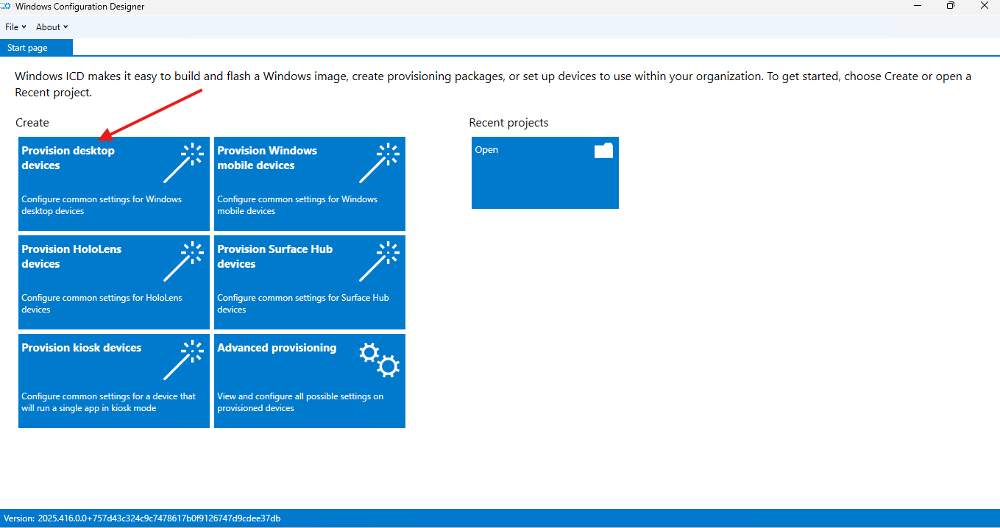
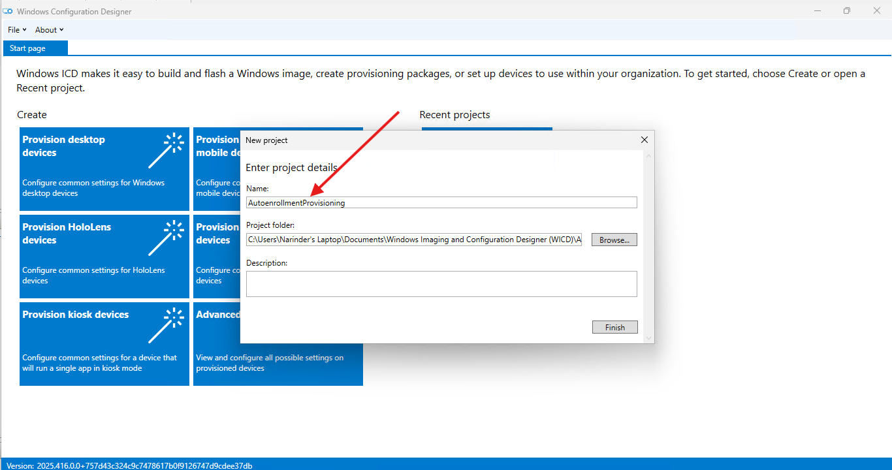
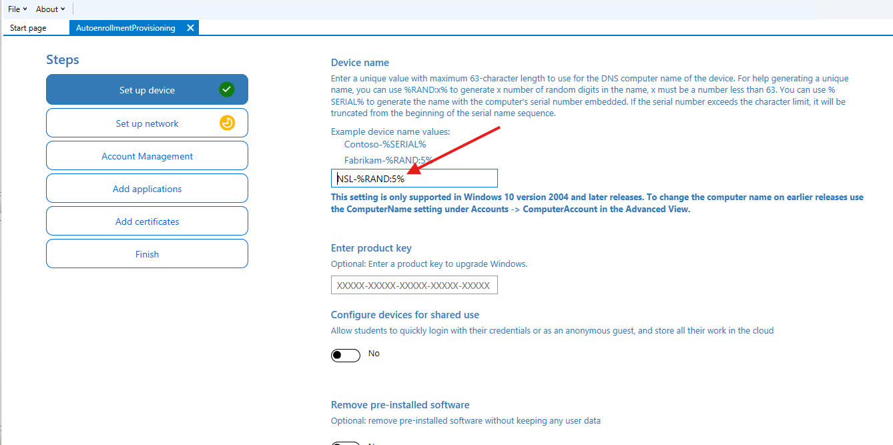
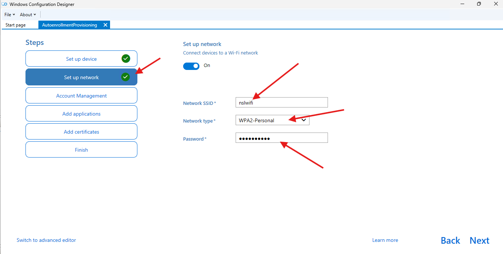
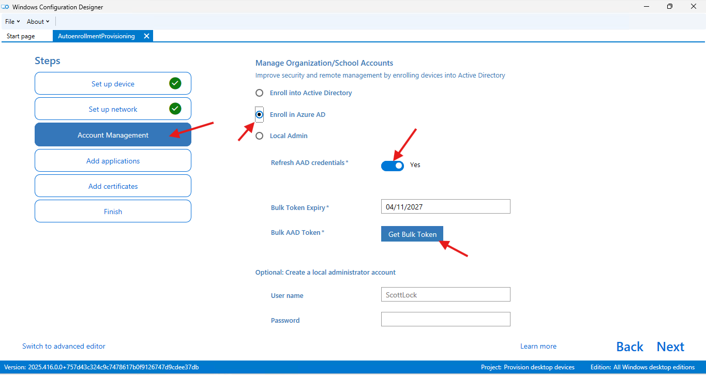
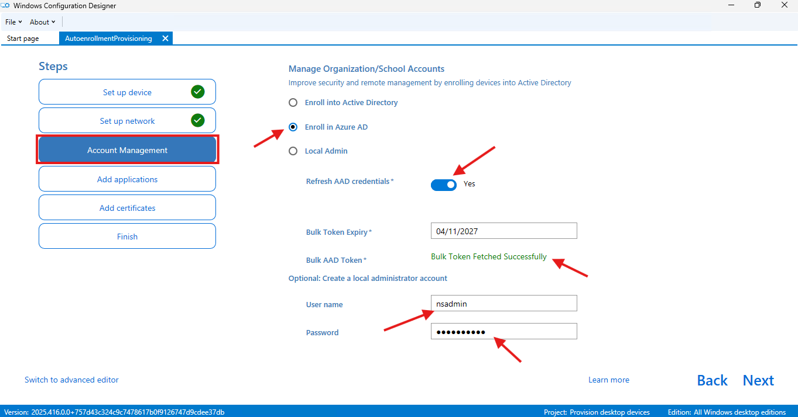
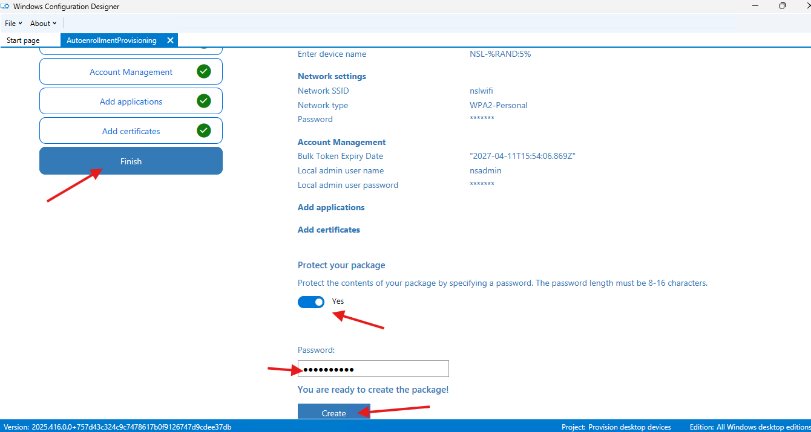
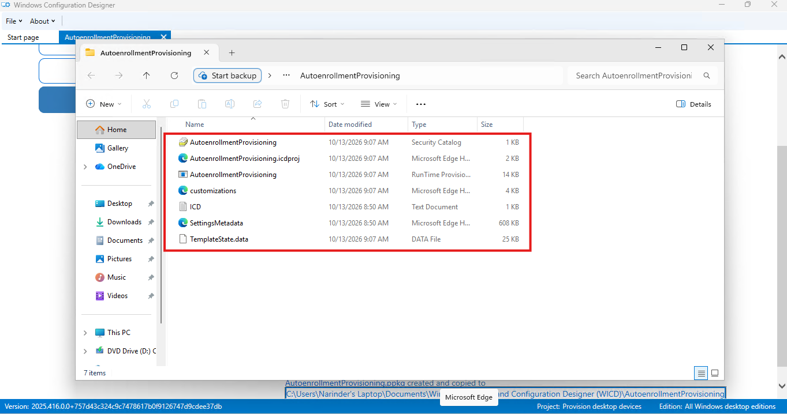

# Windows Provisioning Package Creation

This work uses Windows Configuration Designer on a Windows client to create a desktop provisioning package for Microsoft Entra join and automatic enrollment. The verified outcome in this batch is a successfully built package.

## Work Completed

- Opened Windows Configuration Designer and started a desktop provisioning project.
- Created `AutoenrollmentProvisioning`.
- Configured the device-name pattern `NSL-%RAND:5%`.
- Entered the lab Wi-Fi settings using WPA2-Personal.
- Selected Enroll in Azure AD and successfully retrieved a bulk token.
- Configured the local administrator account `nsadmin`.
- Enabled password protection for the provisioning package.
- Built `AutoenrollmentProvisioning.ppkg` and reviewed the generated files.

## Phase 1 — Create the Desktop Provisioning Project

I opened Windows Configuration Designer, selected Provision desktop devices, and named the project `AutoenrollmentProvisioning`. This established the project used for the device, network, account, and package-protection settings.

  
  

_Left: The desktop provisioning workflow in Windows Configuration Designer. Right: The AutoenrollmentProvisioning project configuration._

## Phase 2 — Configure Device Naming and Network Access

I configured `NSL-%RAND:5%` so the computer name would use the NSL prefix followed by five random digits. I added the lab Wi-Fi SSID `nslwifi` with WPA2-Personal and entered the network password. The password is masked in the screenshot.

  
  

_Left: The NSL-%RAND:5% naming pattern. Right: Lab Wi-Fi settings with the password masked._

## Phase 3 — Retrieve the Bulk Token and Configure Local Administration

I selected Enroll in Azure AD, enabled Refresh AAD credentials, and requested a bulk token. Windows Configuration Designer displayed Bulk Token Fetched Successfully. I also configured `nsadmin` as the local administrator account, with its password masked in the captured view.

  
  

_Left: The Microsoft Entra join option and bulk-token request action. Right: Successful token retrieval and the configured local administrator account._

The summary records the token expiry as `2027-04-11T15:54:06.869Z`. The screenshot shows a success message rather than the token value itself. The tenant used to issue the token is not visible in these package screenshots.

## Phase 4 — Protect and Build the Package

I reviewed the configured values and enabled password protection before creating the package. Windows Configuration Designer then confirmed that `AutoenrollmentProvisioning.ppkg` was created and copied to the project directory.

  
  

_Left: The final project review and package-protection setting. Right: Successful creation of AutoenrollmentProvisioning.ppkg._

## Phase 5 — Verify the Output Files

I reviewed the project folder in File Explorer and confirmed the generated runtime provisioning package, security catalog, project, and supporting files.

  

_The generated provisioning package and its supporting project files in File Explorer._

## Skills Demonstrated

- Windows Configuration Designer desktop provisioning
- Randomized computer-name configuration
- Wi-Fi provisioning settings
- Microsoft Entra bulk-token retrieval
- Local administrator account configuration
- Password-protected provisioning-package creation
- Package-build and output-file verification

## Result

The password-protected provisioning package was built successfully and its output files were verified. Applying it to a test device and checking the resulting Microsoft Entra and Intune records are the next validation steps.

The complete screenshot sequence is available in [screenshots/04-windows-provisioning-package](../screenshots/04-windows-provisioning-package).
